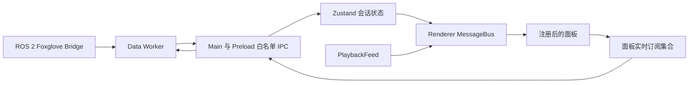

# M2.1 可视化面板架构

## 现有工程审计

| 位置 | 既有职责 | M2.1 处理 |
| --- | --- | --- |
| Renderer 与 Zustand `useAppStore` | 主导航、会话状态、原始消息、遥测与日志 | 继续接收同一份 IPC 事件，将实时话题与采样预览交给总线 |
| `Panel.tsx` | 共有标题、操作区与内容外壳 | 直接作为工作区面板卡片 |
| `LivePage.tsx` | Bridge 侧栏、统计位置偏好、原始消息查看 | 增加工作区入口，保留原始消息和统计布局 |
| Data Worker 与 `FoxgloveClient` | 唯一 ROS 连接、发现、订阅、CDR 解码与采样 | 复用已有 `subscribe`、`unsubscribe`，合并手动与面板话题 |
| IPC 白名单与 Preload | 受限的会话命令与事件 | 增加用于完整替换面板实时 Topic 集合的受限命令 |
| 统一总线 | 原先只有遥测通知和 Zustand 快照 | 增加 Renderer 内的共享 MessageBus 与 PlaybackFeed |

## 运行结构

Renderer 通过 `PanelRegistry` 解析布局中的面板类型。可执行视图和 schema 探测来自同一构建内的显式注册，持久化布局保存数据配置。工作区按二叉分屏树递归放置面板与分隔条，Zustand 管理布局操作，Chromium 用户配置里的 localStorage 自动保存。

每个面板把数据源、话题作为独立配置。React 挂载订阅，改绑会释放旧引用，关闭、离开工作区、注销类型或进入错误降级都会卸载订阅视图。总线按数据源与话题计数和派发。Data Worker 按手动订阅和面板订阅的并集操作 Bridge。同一 Topic 的最后一个面板消失时，如果侧栏仍拥有手动订阅，Worker 继续收流。

本阶段的实时输入是已解码且裁剪的预览。历史输入由 `PlaybackFeed` 接收生产者提交的帧，工作区通过相同的 `MessageEnvelope` 处理。三个内置面板显示绑定状态与时间戳。文件读取、回放时钟和专业 Viewer 渲染留在后续阶段。

[面板 API](PANEL_API.md) · [数据总线 API](DATA_BUS_API.md) · [工作区格式](WORKSPACE_SCHEMA.md) · [验收记录](M2.1_TEST_REPORT.md)
