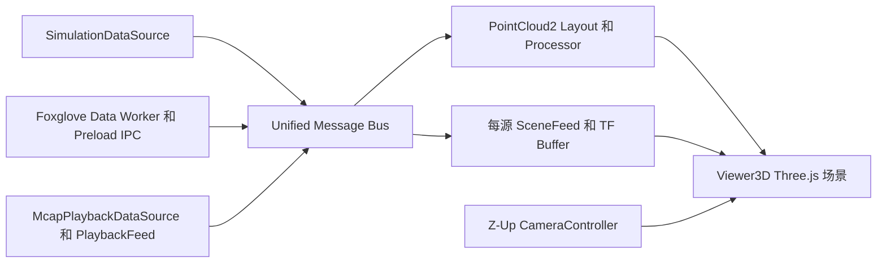

# LabScope M2.2 三维可视化架构

## 数据与坐标

现有 Panel Registry、工作区、实时协议客户端和 M2.2.2 GPU 点云管线继续工作。面板通过 MessageBus 订阅 `(source, topic)`。模拟器使用用户选定的固定种子与模拟时钟。回放从本地 File 切片读取索引 MCAP，按 `logTime` 调度 CDR，按 ROS `header.stamp` 做空间变换。实时 Worker 沿用 Preload 消息边界，对面板提供完整点云与空间事件，手动监控继续使用有界预览。

三维场景统一使用 ROS 的 X 向前、Y 向左、Z 向上。PointCloud Processor 输出原坐标位置与颜色，渲染层将时间匹配的刚体变换设在 Points 对象上，切换参考系无需改写源消息。Pose、Odometry、Path 每个采样点以及 Marker 使用同一个按源隔离的 TF 缓存。使用不同数据源叠加时，用户需要确认同名 Fixed Frame 的物理意义一致。[ROS REP 103](https://github.com/ros-infrastructure/rep/blob/master/rep-0103.rst) · [TF 数学与缓存](TF_ENGINE.md)

## 显示队列与资源

每个点云图层保持一条尚未处理的消息以及一个待 TF 配对的处理结果。下一条显示样本可覆盖这两个位置。未来 TF 的短暂等待保留先前变换成功的画面，并显示原因。可确定的缺链、过期或非法消息使对应图层暂停。复用 CPU 类型数组和 WebGL2 位置、颜色 VBO，容量增长时重新分配 VBO 存储，日常只上传绘制区间。TF 连接线、Path 与 Odometry 轨迹复用顶点属性。Marker 按源、话题、Namespace 和 ID 维护，形状改变时释放旧几何，普通 Pose/Color 更新复用对象。

总线的源重置通知清除 TF、轨迹、Marker 和点云。回放 seek 先重置源，再重建历史的静态 TF 与 Marker 操作，读取动态 TF 缓存及第一个后续插值样本，并恢复各话题最近消息。暂停冻结回放时钟和 Marker 生命周期。播放时每泵处理最多 16 条，积压时逻辑进度随已消费数据更新。实时增量的 TF 与 Marker 以每话题 64 条、8 MiB 线载荷预算在遥测周期内分批，单条空间消息上限 2 MiB。显示抽样、失败和队列不会回写原始消息。

关闭图层或面板释放订阅。Viewer 清理动画、视窗监听、轨道控制、计时查询、几何、材质、标签和 GL 上下文。工作区延续 v1 序列化，将 Fixed Frame、投影、相机位置、目标、图层颜色和显示配置持久化。

## 回放范围

回放支持带 ChunkIndex 的 ROS 2 `ros2msg` / CDR 文件、无压缩及 Zstd 块。读块与解压上限为 128 MiB。用户通过 Electron 文件控件选择本地文件。MCAP 写入与重建索引由数据管理阶段负责。[MCAP TypeScript SDK](https://mcap.dev/docs/typescript/classes/_mcap_core.McapIndexedReader) · [操作指南](VIEWER3D_USER_GUIDE.md)

新增依赖锁定为 `@mcap/core@2.4.0` 和 `fzstd@0.1.1`，两者包元数据均为 MIT。使用 `pnpm fixture:simulation-mcap <新文件路径>` 生成验收样例，脚本拒绝覆盖现有文件。
